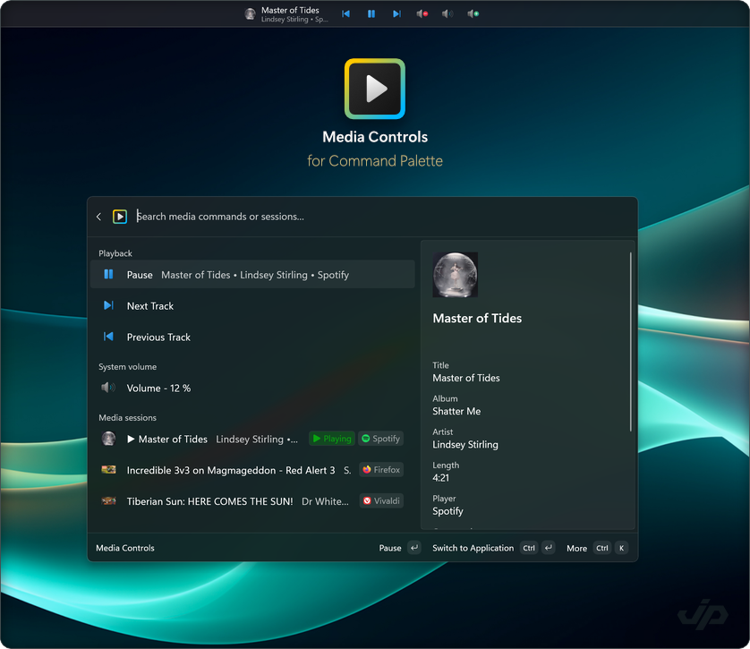

<div align="center">


<h1 align="center"><span style="font-weight: bold">Media Controls</span> <br /><span style="font-weight: 200">for Command Palette</span></h1>

</div>

Control music and video playback, switch between players, and adjust system volume from [PowerToys Command Palette](https://learn.microsoft.com/en-us/windows/powertoys/command-palette/overview) and its Dock.

Version 0.40 brings Windows media and direct player integrations into one media-source system. Windows media controls now run separately from the extension for better stability and recovery. These changes provide the foundation for desktop iTunes and local or remote VLC 3 support.

<div align="center">

</div>

## Features

- **Playback controls** — Play, pause, stop, skip tracks, and change shuffle or repeat mode when supported by the player.
- **Multiple players** — See what's playing across your apps and browser tabs, switch between players, and optionally pause other players when starting playback.
- **Now playing details** — See the track, artist, album, and artwork, with a details page for additional metadata.
- **System volume** — Adjust or mute the default Windows playback device directly from Command Palette.
- **Quick access** — Control playback from the home page, find media commands in global search, or use keyboard shortcuts.
- **Dock integration** — Keep the current track, playback controls, and system volume within reach from the Dock.
- **Personalization** — Choose separate icon themes for the Command Palette and Dock, use album art in the session list, configure which commands appear on each surface, and choose what the first dock item does (bring the app to front, open the main page, or open media details).

## Supported players

Media Controls works with apps and browser tabs that support Windows media controls, including Spotify, Apple Music, foobar2000, Media Player, VLC UWP, and media websites in Edge, Chrome, and Firefox. Available controls and track details depend on the player.

You can also enable direct support for [desktop iTunes](docs/user/itunes-backend.md) or connect to [VLC 3](docs/user/vlc-backend.md), including a VLC player on another computer on your network. Set up these optional integrations from **Media sources** in the Media Controls command menu.

See [Media sources setup](docs/user/media-sources.md) for configuration and troubleshooting, the [player compatibility guide](docs/user/GSMTC-Compatibility.md) for supported features, and the [changelog](CHANGELOG.md) for release notes.

## Installation

> **Note:** This extension requires [Microsoft PowerToys](https://apps.microsoft.com/detail/xp89dcgq3k6vld) to be installed.

### Microsoft Store installation (recommended)

<a href="https://apps.microsoft.com/detail/9N3BQ81G19K7"></a>

### Command Palette


- Open the Command Palette.
- Navigate to the page *Install Command Palette extensions*.
- From the list of extensions, select *Media Controls for Command Palette*.

### WinGet

- Open a terminal.
- Run:

  ```pwsh
  winget install -e --id JiriPolasek.MediaControlsforCommandPalette
  ```

### Manual installation

- Download the MSIX installer from the [Releases](https://github.com/jiripolasek/MediaControlsExtension/releases) section and run it.

## Licence

Apache 2.0

## Author

[Jiří Polášek](https://jiripolasek.com)

## Very special thanks

[Mike Griese](https://github.com/zadjii-msft)
